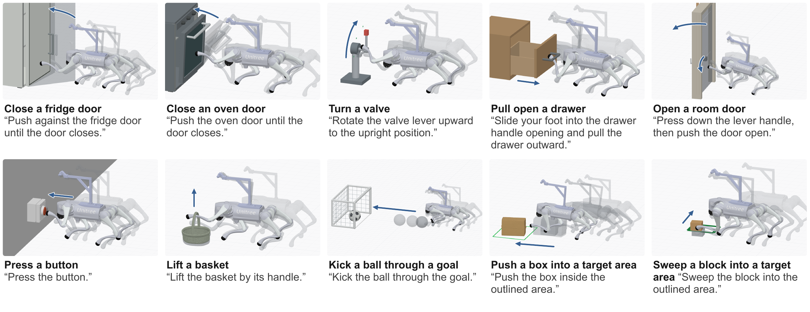
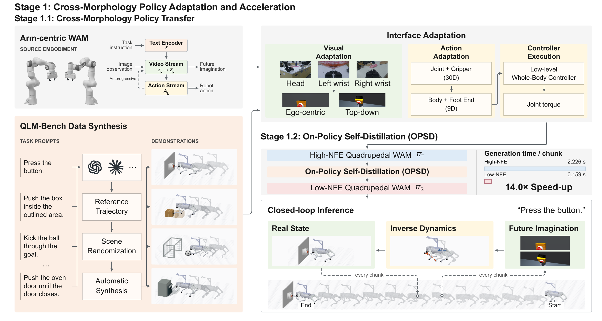
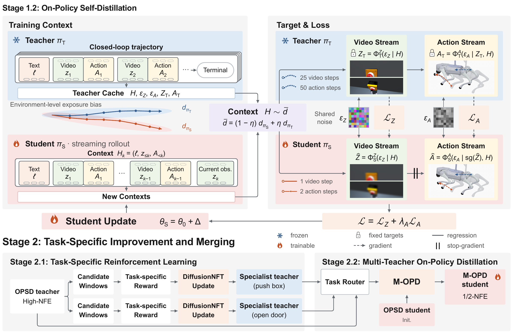

# WAM-Policy: World Action Models with On-Policy Distillation for Quadrupedal Loco-Manipulation

Code implementation for the paper below.

> **WAM-Policy: World Action Models with On-Policy Distillation for Quadrupedal Loco-Manipulation**
>
> [Junlin Long](https://github.com/JalenLoong)\*, [Xu Deng](https://github.com/Ethan-Xu-Deng)\*, [Yiran Wang](https://scholar.google.com/citations?user=eg_nBF0AAAAJ&hl=en), [Yue Yang](https://au.linkedin.com/in/yue-yang-982714286)†, [Yang Zhao](https://yangyangkiki.github.io/)†, and [Zeyu Zhang](https://steve-zeyu-zhang.github.io/)‡
>
> \*Equal contribution. †Corresponding authors. ‡Project lead.
>
> #### [Website](https://aigeeksgroup.github.io/WAM-Policy/) | [Models](https://huggingface.co/AIGeeksGroup/WAM-Policy) | [QLM-Bench](https://github.com/AIGeeksGroup/QLM-Bench) | [Dataset](https://huggingface.co/datasets/AIGeeksGroup/QLM-Bench)

## ✏️ Citation

Citation will be added after publication.

---

## 🏃 Introduction

WAM-Policy turns one WAM into a quadrupedal loco-manipulation policy via two stages, one for each challenge: Cross-Morphology Policy Adaptation and Acceleration (Stage 1) and Task-Specific Improvement and Merging (Stage 2). Both stages end by distilling a high-NFE teacher, the policy itself in Stage 1 and the task-routed teachers in Stage 2, on-policy into a 1/2-NFE student (one video and two action steps), so the final policy is stronger than the transferred one at a fraction of its inference cost.


- **Cross-morphology adaptation and acceleration.** Stage 1 replaces only the visual and action interfaces of a WAM, fine-tunes it on quadruped demonstrations, and accelerates it by a few-step form of on-policy self-distillation (OPSD) ([Zhao et al.](https://arxiv.org/abs/2601.18734)), in which the same network with more sampling steps labels the student's own samples. The transferred policy reaches 77.0%, and the OPSD student keeps 76.7% (69.3% without distillation) while sampling 14 times faster.
- **Task-specific improvement and merging.** Stage 2 tunes specialist teachers by per-task reinforcement learning and merges them by multi-teacher on-policy distillation (M-OPD) ([Ni et al.](https://arxiv.org/abs/2610.21522)), which routes each context to the teacher of its task. On pushing a box and opening a door, the specialists succeed in every episode, against 47% and 53% for the OPSD teacher, and the M-OPD student reaches 90% and 87%, raising the ten-task success from 76.7% to 85.0%, above the OPSD teacher (77.0%).
- **QLM-Bench**, ten simulated loco-manipulation tasks with 1,000 language-annotated demonstrations synthesized without teleoperation, and evaluation in simulation and on a real Unitree Go2 Air, where the OPSD student runs without real-robot data.

## 📦 Data Preparation

The simulator, tasks, RAMBO controller, demonstrations and the Standard100 benchmark live in the
companion repository [QLM-Bench](https://github.com/AIGeeksGroup/QLM-Bench). This repository talks to it through the `qlm_bench` Python package
(qlm-live-v1 policy protocol, training-environment workers, Task RL scene workers, benchmark runner).



### QLM-Bench Demonstrations

After [installation](#installation), prepare the ten QLM-Bench demonstration releases (1,000 episodes split into 800 train, 100 validation and 100 test).

```bash
source configs/site.env
scripts/download.sh base
scripts/stage1_1_transfer/prepare_data.sh   # download releases -> fit train-split normalizer -> frozen VAE/T5 cache (1 GPU)
```

### Reset Pool and Standard100

Get the reset pool once (also used by M-OPD): `scripts/download.sh reset_pool` downloads
`reset_pools/train800-reset-pool.tar` from the dataset and extracts it (keep tar's hard links) to
`$QLM_BENCH_SNAPSHOT/reset_pools/train800-reset-pool/`; `QLM_TRAIN_POOL` points at its `manifest.json`.

```bash
scripts/download.sh reset_pool    # train800 for Stages 1.2 and 2.2
scripts/download.sh standard100   # Standard100 cases and assets
```

## ⚙️ Environment Setup

### Installation

Two Python environments are used, because the simulator and the model have different dependencies:

1. **Model environment** (GPU; CUDA or ROCm), Python ≥ 3.10 (the paper used 3.10):
   ```bash
   pip install -e ".[policy,data]"          # torch 2.9, diffusers 0.36, transformers 4.55, PyAV, datasets
   pip install --no-deps lerobot==0.3.3     # LeRobot's dataset reader; its metadata pins torch<2.8, it runs on 2.9
   ```
   The exact CUDA 12.8 environment of the paper's evaluation is `requirements/policy-cuda128.lock`
   (`pip install --no-deps -r requirements/policy-cuda128.lock && pip install --no-deps -e .`; it
   carries the PyTorch cu128 index). Paper training ran on ROCm PyTorch (8×AMD MI355X); install the
   ROCm build of PyTorch 2.9 there first.
2. **QLM-Bench environment** (CPU physics, EGL/OSMesa rendering; Python ≥ 3.11, the paper used 3.12):
   ```bash
   git clone https://github.com/AIGeeksGroup/QLM-Bench.git
   pip install -r QLM-Bench/requirements/mujoco-cpu.txt && pip install --no-deps -e QLM-Bench
   ```
   In the model environment (Python 3.10 is fine) also install the policy protocol:
   `pip install -e "QLM-Bench[live]"` (the launchers here additionally put `$QLM_BENCH_SRC` on `PYTHONPATH`).
   Set `QLM_BENCH_SRC=<checkout>/src` and `QLM_PYTHON` (the interpreter of the QLM-Bench environment) in
   `configs/site.env`. Keep the full checkout: Stage 2.1 reads `<checkout>/inputs/task_rl/`.

Then copy and edit the site configuration — every repository id, account and local path is read from it:
```bash
cp configs/site.example.env configs/site.env && $EDITOR configs/site.env && source configs/site.env
```
W&B logging and uploads are off unless enabled there (`WANDB_MODE`, `WAM_UPLOAD_REPO`).

### Pretrained Checkpoints

Hugging Face model repository [`AIGeeksGroup/WAM-Policy`](https://huggingface.co/AIGeeksGroup/WAM-Policy), branch `main`
(set by `WAM_HF_MODEL_REPO` / `WAM_HF_MODEL_REVISION`):

| Directory | Paper name | Sampler (video/action NFE) |
|---|---|---|
| `stage1_1_teacher/` | Stage 1.1 teacher (SFT, 5,000 steps) | 25/50 |
| `stage1_2_opsd_student/` | OPSD student (S300 EMA, LoRA-256) | 1/2 |
| `stage2_1_specialists/push_box/`, `stage2_1_specialists/open_room_door/` | Task-specific RL specialists (LoRA-32 on the teacher) | 25/50 |
| `stage2_2_mopd_student/` | M-OPD student (S300 EMA, LoRA-256) | 1/2 |
| `prompt_embeddings/<task>/embedding.pt` | frozen T5 embeddings of the ten task instructions | – |

Each directory has a small `wam_policy.json` (format in `src/wam_policy/models/metadata.py`);
`paper_checkpoints.json` at the repository root maps the paper's names to these directories.
(`scripts/release/convert_checkpoint_metadata.py` is for maintainers only: it produced these
`wam_policy.json` files from the paper checkpoints' original metadata; reproducers never need it.)
Students and specialists are LoRA adapters applied, unmerged, on top of the teacher.
The VAE and text encoder come from the upstream base model `robbyant/lingbot-va-base`
(revision `68b7bc1b35da6ddc67ea94c4ceb58d768fbb3f9c`), which is not redistributed here.

```bash
scripts/download.sh weights        # final checkpoints and prompt embeddings -> $WAM_WEIGHTS
scripts/download.sh base           # -> $WAM_BASE_MODEL (vae/, text_encoder/, tokenizer/, transformer/)
scripts/download.sh standard100    # -> $QLM_RESOURCES (QLM-Bench environment)
scripts/download.sh reset_pool     # train800 reset pool for Stages 1.2 / 2.2 -> $QLM_TRAIN_POOL
scripts/download.sh prompts        # only prompt_embeddings/ (smoke tests without the model weights)
```

The checkpoint index lists the optional weights under `ablations/quadruped/` and `ablations/arm_libero/`.
The following command downloads the quadruped teacher-cache-only S300 EMA.

```bash
huggingface-cli download "$WAM_HF_MODEL_REPO" --revision "$WAM_HF_MODEL_REVISION" \
  --include 'ablations/quadruped/teacher_cache_only/s300_ema/*' --local-dir "$WAM_WEIGHTS"
```

Use the resulting directory as the adapter argument to `scripts/evaluation/standard100.sh opsd_student`.
For an arm checkpoint, use `fetch-student --name` as described in the [arm README](supplementary/arm_libero/README.md#evaluation).

### Smoke Tests

Each main chain has one minimal-scale entry in `scripts/smoke/` that also checks the environment:

| Chain | Command | What it runs |
|---|---|---|
| Stage 1.1 | `scripts/smoke/stage1_1_sft.sh` | tiny 30D→9D conversion, 2-rank CPU SFT, resume, export, `load_teacher` (CPU, ~1 min) |
| Stage 1.2 OPSD | `scripts/smoke/opsd.sh` | tiny model: teacher cache → updates (history reuse on/off compared) → resume → export → deployment sampler (CPU, seconds) |
| Stage 2.1 Task RL | `scripts/smoke/task_rl_push_box.sh` | push_box at tiny scale with real QLM-Bench scene workers: pool → one round → export → attach (GPU ~2 GB, ~6 min) |
| Stage 2.2 M-OPD | `scripts/smoke/mopd.sh` | tiny model: specialist routing → specialist cache merge → updates from an exported student → export (CPU, seconds) |
| Standard100 | `scripts/smoke/standard100.sh` | random tiny teacher served over qlm-live-v1 for one Standard100 episode with the QLM-Bench runner |

They need `configs/site.env`; Task RL and Standard100 also need the QLM-Bench environment, the VAE
(`scripts/download.sh base`) and the prompt embeddings (`scripts/download.sh prompts`, a few MB).
None needs the model weights.

## 🚀 Training

The repository follows the paper:

| Stage | What it does | Code | Configs / scripts |
|---|---|---|---|
| 1.1 Cross-Morphology Policy Transfer | adapt LingBot-VA to the Go2 (dual-view 360p RGB, native 9D command), SFT on the 800 training demonstrations of QLM-Bench → **teacher** | `wam_policy.transfer`, `wam_policy.data`, `wam_policy.models` | `configs/stage1_1_transfer/`, `scripts/stage1_1_transfer/` |
| 1.2 OPSD | on-policy self-distillation of the 25/50-NFE teacher into a 1/2-NFE **student** | `wam_policy.opsd` | `configs/stage1_2_opsd/`, `scripts/stage1_2_opsd/` |
| 2.1 Task-Specific RL | window-level DiffusionNFT on the teacher → per-task **specialist** LoRA adapters | `wam_policy.task_rl` | `configs/stage2_1_task_rl/`, `scripts/stage2_1_task_rl/` |
| 2.2 M-OPD | multi-teacher OPD: task-routed specialist teachers distilled into the OPSD student → **M-OPD student** | `wam_policy.mopd` (+ `wam_policy.opsd` engine) | `configs/stage2_2_mopd/`, `scripts/stage2_2_mopd/` |
| Evaluation | QLM-Bench Standard100 (100 cases; seeds 42/43/44 = 300 episodes) | `wam_policy.inference`, `wam_policy.evaluation` | `configs/evaluation/`, `scripts/evaluation/` |
| Ablation | RGB + proprioception input (Stage 1.1 variant) | `wam_policy.ablations.proprioception` | `configs/ablations/proprioception/`, `scripts/ablations/proprioception/` |

### Stage 1.1 Cross-Morphology Policy Transfer



**Input:** LingBot-VA base (`robbyant/lingbot-va-base@68b7bc1`), the ten QLM-Bench demonstration
releases (1,000 episodes; 800/100/100 train/validation/test). **Output:** the teacher.

```bash
source configs/site.env
scripts/stage1_1_transfer/convert_base.sh        # 30D -> native 9D action head (xavier, seed 0); CPU
scripts/stage1_1_transfer/prepare_data.sh        # download 10 releases -> fit train-split normalizer -> frozen VAE/T5 cache (1 GPU)
NPROC=8 scripts/stage1_1_transfer/train.sh       # torchrun SFT, configs/stage1_1_transfer/teacher_sft.json
# only if you do not use the released prompt_embeddings/ (re-encoding is not byte-identical):
python scripts/stage1_1_transfer/encode_prompts.py --base-model $WAM_BASE_MODEL --output $WAM_ROOT/prompt_embeddings
```
The run ends with a release-format teacher in `<run>/teacher/` (`wam_policy.json` + `transformer/`);
`python -m wam_policy.transfer export` re-exports any checkpoint and `--resume` continues a run (the
training settings must match the checkpoint). With fewer GPUs, add `--accumulation $((8 / NPROC))` to
keep the global batch of 8. To continue the later stages from your own teacher instead of the released
one, set `WAM_TEACHER=<run>/teacher` in `configs/site.env`. The individual steps are `python -m wam_policy.models.native9`,
`python -m wam_policy.data {download,inspect,fit,cache}` and `python -m wam_policy.transfer {train,export}`.

**Hardware and time (paper):** 8×AMD MI355X, global batch 8 (one whole episode per GPU), 5,000 AdamW
steps (lr 1e-5, 10 warm-up steps): about 14 h. Data caching needs one GPU.
**Paper:** Table "Success rate (%) on QLM-Bench Standard100" (teacher, 25/50 NFE) and Table
"Sampling steps without distillation" (2/4 and 1/2 NFE; evaluate with `--video-steps/--action-steps`).

### Stage 1.2 OPSD



**Input:** the Stage 1.1 teacher, the QLM-Bench train800 reset pool, prompt embeddings.
**Output:** the OPSD student (and a teacher target cache, reused by M-OPD).

```bash
source configs/site.env
# 1) teacher target cache (25/50 teacher on the training environments; 5,000 contexts)
scripts/stage1_2_opsd/build_teacher_cache.sh "$WAM_ROOT/runs/opsd-teacher-cache"   # -> $OPSD_TEACHER_CACHE
# 2) OPSD, eta = 0.5, 300 updates (configs/stage1_2_opsd/opsd.json)
scripts/stage1_2_opsd/train.sh "$WAM_ROOT/runs/opsd"
#    ablations: scripts/stage1_2_opsd/train.sh "$WAM_ROOT/runs/<name>" configs/stage1_2_opsd/ablations/<name>.json
# the paper student: $WAM_ROOT/runs/opsd/learner/students/step_00000300/ema (release student format)
```
To start M-OPD from your own student, set `OPSD_STUDENT=$WAM_ROOT/runs/opsd/learner/students/step_00000300/ema`
(the default points at the released OPSD student).
`python -m wam_policy.opsd {cache,train,export,finalize-cache,smoke}`; configs read the paths from
`configs/site.env` (`WAM_TEACHER`, `QLM_TRAIN_POOL`, `QLM_PYTHON`, ...) and accept `--set FIELD=VALUE`.
One learner rank per GPU is launched with torchrun, each with its own QLM-Bench CPU worker
(`python -m qlm_bench.training_env worker`). `--resume <checkpoint>` continues a run; settings that do
not change the algorithm (timeouts, `worker_wall_timeout_s`, ...) can be changed with `--set` when
resuming. The recipe assumes **8 ranks** (24 on-policy + 24 cached contexts per update); there is no
equivalent setting for fewer GPUs (cache building may use fewer). `longer_training` (900 updates,
about 26 h) raises the worker budget to 48 h.

**Recipe:** student = teacher + LoRA-256 on the self-attention and FFN projections; every update
regresses the 1/2-NFE student onto same-noise 25/50 teacher endpoints for 24 on-policy contexts
(eight CPU QLM-Bench training environments) plus 24 contexts from the offline teacher cache
(η = 0.5); lr 3e-5 after a 20-step warm-up; EMA 0.99 from update 50. The paper reports the S300 EMA
student, so the paper config runs 300 updates.
**Ablations (configs/stage1_2_opsd/ablations/):** `teacher_cache_only` (η = 1, 2,000 updates on the cache),
`streaming_only` (η = 0, on-policy contexts only), `longer_training` (900 updates).
**Hardware and time (paper):** 8×AMD MI355X; about 8 h for the 300 updates (about 100 s per update),
plus the teacher cache (5,000 contexts).
**Paper:** Table "Success rate (%) on QLM-Bench Standard100" (OPSD student), Table "Training contexts"
(`teacher_cache_only`, `streaming_only`) and Table "Longer training" (`longer_training`).

### Stage 2.1 Task-Specific RL

**Input:** the Stage 1.1 teacher, QLM-Bench Task RL inputs (`<QLM-Bench>/inputs/task_rl/<task>/`), the
RAMBO controller. **Output:** one specialist adapter per task (`push_box`, `open_room_door`).

```bash
source configs/site.env      # WAM_TEACHER, WAM_BASE_MODEL, WAM_PROMPTS, QLM_BENCH_SRC, QLM_PYTHON
TASK=push_box       RUN=runs/task_rl/push_box       GPUS=8 EXPORT_ROUND=r14 scripts/stage2_1_task_rl/run_task_rl.sh
TASK=open_room_door RUN=runs/task_rl/open_room_door GPUS=8 EXPORT_ROUND=r04 scripts/stage2_1_task_rl/run_task_rl.sh
```
The driver prepares the task's scenes from `<QLM-Bench>/inputs/task_rl/<task>/`, builds and splits the
start-state pool from teacher episodes, then runs rounds (candidate collection with window-shared
noise → window rewards → DiffusionNFT update of the LoRA-32 adapter → EMA → probe) until the stop rule;
every step resumes from disk. `python -m wam_policy.task_rl export --run <run> --round rNN --output <dir>`
writes a release specialist; the driver writes `$RUN/specialist-$EXPORT_ROUND`. To use your own
specialists in M-OPD, set `MOPD_PUSH_BOX_SPECIALIST=runs/task_rl/push_box/specialist-r14` and
`MOPD_OPEN_ROOM_DOOR_SPECIALIST=runs/task_rl/open_room_door/specialist-r04` (the defaults point at the
released ones). Task profiles (`wam_policy.task_rl.tasks.push_box`,
`...open_room_door`) hold the task-specific rewards, start rules and tables; the rest is shared
(`wam_policy.task_rl.core`). The open_room_door specialist is the round chosen by the in-training
evaluation (r04). Rendering uses OSMesa by default (`GL=egl` selects EGL; RGB is then not
bit-reproducible across runs).

**Hardware and time (paper):** one node with 8×AMD MI355X, rows = 8; about 5 h (push_box) and 9 h
(open_room_door). The released specialists are round 14 (push_box) and round 4 (open_room_door).
`PROMPT_ROOT` (the released `prompt_embeddings/`) is required, as in the paper runs.
**Paper:** the specialist rows of Table "Success rate (%) on QLM-Bench Standard100" (each specialist
is evaluated on all ten tasks).

### Stage 2.2 M-OPD

**Input:** the OPSD student (S300 EMA) as the initial student, the two specialists as task-routed
teachers, and the **teacher target cache built by the Stage 1.2 cache stage** (`previous_cache`):
run the OPSD cache stage first. **Output:** the M-OPD student.

```bash
source configs/site.env      # OPSD_TEACHER_CACHE, OPSD_STUDENT, MOPD_*_SPECIALIST
# 1) specialist teachers re-collect their own tasks; their entries replace those tasks in the OPSD cache
scripts/stage2_2_mopd/build_specialist_cache.sh "$WAM_ROOT/runs/mopd-teacher-cache"   # -> $MOPD_TEACHER_CACHE
# 2) M-OPD, 300 updates from the OPSD S300 EMA student (configs/stage2_2_mopd/mopd.json)
scripts/stage2_2_mopd/train.sh "$WAM_ROOT/runs/mopd"
```
`python -m wam_policy.mopd {cache,merge,train,export,smoke}`; specialists are passed as release
directories (`--expert push_box=<dir>`, or `resources.experts` in the config). Contexts of
`push_box` and `open_room_door` are taught by the teacher plus that task's specialist adapter, every
other task by the plain teacher. Previously built caches cannot be imported: rebuild them with the
commands above (results will not be bit-identical to the paper runs).

The paper uses two specialists, {push_box, open_room_door}; the routing table is printed at start, and
an unset specialist variable is an error. Like OPSD, the recipe assumes 8 ranks.
**Hardware and time (paper):** 8×AMD MI355X, 300 updates, about 5 h.
**Paper:** the M-OPD row of Table "Success rate (%) on QLM-Bench Standard100"; paired tests in the
supplementary Table "Paired comparisons on QLM-Bench".

### Default vs. Accelerated Settings

Every switch defaults to the plain (not accelerated) behaviour; the paper configs turn on what the
paper used. Differences between the two paths are noted in the table.

| Where | Default | Accelerated | Paper |
|---|---|---|---|
| OPSD / M-OPD learner history (`history_reuse`) | full prefix replay | exact reuse of history K/V (value-identical) | on |
| QLM training-environment rendering (`render_mode`) | `full`: every tick + observer camera | `sampled`: render only at the 40-tick sample points, no observer (policy frames bit-identical) | OPSD `full`; M-OPD and Task RL `sampled` |
| Task RL candidate collection / start pool / in-training evaluation (`rows`) | 1 (row by row) | 8 rows batched (same starts, candidates, seeds and gradient batches; samples agree to bf16 rounding, not bit for bit) | 8 |
| Standard100 | single service, single client, VAE on CPU | multi-session resident service, VAE on GPU (bf16 rounding differences only) | both (results merged) |

## 📊 Evaluation

### Quick start: evaluate a released policy

```bash
source configs/site.env
# Stage 1.2 OPSD student on Standard100 (seed 42 = 100 episodes), one policy service + one client
scripts/evaluation/standard100.sh opsd_student runs/eval/opsd "$WAM_WEIGHTS/stage1_2_opsd_student" --seeds 42
```
This runs `python -m wam_policy.inference.serve` (model environment) and
`python -m qlm_bench.benchmark run` (QLM-Bench environment) and writes `trials.csv` and
`summary.json`. A 16 GB GPU is enough (30 transformer blocks on the GPU, VAE on the CPU).

### QLM-Bench Standard100 evaluation

One unified policy server serves every model over qlm-live-v1 (two 640×360 RGB views + instruction →
a 16×9 native9 command chunk, 0.32 s):

```bash
python -m wam_policy.inference.serve --policy {teacher,specialist,opsd_student,mopd_student} \
    --teacher $WAM_WEIGHTS/stage1_1_teacher [--adapter <student or specialist dir>] \
    --base-model $WAM_BASE_MODEL --prompt-root $WAM_PROMPTS \
    [--video-steps 25 --action-steps 50] [--vae-device cpu] [--offload-blocks N] --port 8862
```
The default NFE is read from the checkpoint metadata (teacher/specialist 25/50, students 1/2); the
teacher and specialists accept any NFE (`--video-steps 1 --action-steps 2` reproduces the
"without distillation" rows).

**Default (not accelerated):** one service, one client per seed, episode by episode:
```bash
python -m wam_policy.evaluation.standard100 --policy <policy> --teacher ... [--adapter ...] \
    --base-model $WAM_BASE_MODEL --prompt-root $WAM_PROMPTS --resource-root $QLM_RESOURCES \
    --qlm-python $QLM_PYTHON --qlm-src $QLM_BENCH_SRC --seeds 42,43,44 --output runs/eval/<name>
```
(`scripts/evaluation/standard100.sh` wraps this.) Seed 42 is Standard100; seeds 43 and 44 repeat it
with different policy noise, giving the 300-episode protocol reported in the paper. Every seed gets a
fresh policy server, as in the paper runs; an interrupted seed resumes from its
partial `result.json`. Server and client use 4 OMP/MKL threads as in the paper runs (`--threads`).
`summary.json` gives the success rate, the per-seed successes ("Seeds") and the standard deviation
over seeds ("±"). The paper's specialist rows cover all ten tasks.

`python -m wam_policy.evaluation.latency <run>/service-seed*/` summarizes the `predict` durations
logged by the policy service for the evaluated configuration. The paper's `0.159 s` per chunk was
measured on an RTX 5070 Ti with the VAE on the CPU and the OPSD S300 EMA LoRA merged into the bf16
teacher weights. The timing probe synchronized CUDA around each `predict` and measured video and
action sampling for one chunk. The success-rate evaluation uses the unmerged adapters.

**Accelerated:** a resident multi-session service with several concurrent clients
(`scripts/evaluation/standard100_accelerated.sh`, see `wam_policy.evaluation.run_parallel`).
For a split across machines, `--jobs` selects individual `case:seed` pairs and runs each pair once.
It overrides `--cases`, `--tasks` and `--seeds`.

```bash
scripts/evaluation/standard100_accelerated.sh mopd_student runs/eval/mopd-gpu "$WAM_WEIGHTS/stage2_2_mopd_student" \
  --jobs push100-20261014-091:42,turn_valve-20261016-091:43
```

After both runners finish disjoint sets of `(case, seed)` trials, combine their `result.json`
files to build one `trials.csv` and `summary.json`. The merge command rejects repeated trials.

```bash
python -m wam_policy.evaluation.trials --result \
  runs/eval/mopd-cpu/seed*/result.json runs/eval/mopd-gpu/seed*/*/result.json \
  --output runs/eval/mopd-merged
```

**Paired statistics:** `python -m wam_policy.evaluation.compare --new runs/eval/<new>/trials.csv --baseline runs/eval/<base>/trials.csv`
(`trials.csv` or `result.json` files; both runners write `trials.csv`) pairs
trials by (case, seed) and reports an exact McNemar test (total, per seed, per task); both sides must
cover the same pairs unless `--allow-partial` is given (supplementary Table "Paired comparisons on QLM-Bench").

Hardware: an RTX 5070 Ti (16 GB) for the default path; the accelerated path was run on an RTX 5090.

### Reproducing the Paper

| Paper | Release entry point |
|---|---|
| Success rate (%) on QLM-Bench Standard100 | [QLM-Bench Standard100 evaluation](#qlm-bench-standard100-evaluation) |
| Training contexts and longer training | [Stage 1.2 OPSD](#stage-12-opsd) and [ablation configs](./configs/stage1_2_opsd/ablations/) |
| Sampling steps without distillation | [QLM-Bench Standard100 evaluation](#qlm-bench-standard100-evaluation), `--video-steps` and `--action-steps` |
| Proprioception in Stage 1.1 | [Ablation: RGB + proprioception](#ablation-rgb--proprioception) |
| Paired comparisons on QLM-Bench | [QLM-Bench Standard100 evaluation](#qlm-bench-standard100-evaluation), `wam_policy.evaluation.compare` |
| Real-robot results on the Unitree Go2 Air | [Real-robot deployment](#real-robot-deployment-unitree-go2) |
| Arm manipulation on LIBERO | [Arm README](./supplementary/arm_libero/README.md) |

### Ablation: RGB + proprioception

A Stage 1.1 variant whose transformer also reads and predicts a 10D proprioceptive state (base
height, gravity direction, linear and angular velocity). It reuses the Stage 1.1 frozen cache.
The SFT5000 checkpoint is available at `ablations/quadruped/rgb_proprioception/s5000/`.
```bash
source configs/site.env
huggingface-cli download "$WAM_HF_MODEL_REPO" --revision "$WAM_HF_MODEL_REVISION" \
  --include 'ablations/quadruped/rgb_proprioception/s5000/*' --local-dir "$WAM_WEIGHTS"
# Standard100, seed 42, 25/50:
python -m wam_policy.evaluation.standard100 --policy proprioception_teacher \
    --teacher "$WAM_WEIGHTS/ablations/quadruped/rgb_proprioception/s5000" \
    --base-model "$WAM_BASE_MODEL" --prompt-root "$WAM_PROMPTS" --resource-root "$QLM_RESOURCES" \
    --qlm-python "$QLM_PYTHON" --qlm-src "$QLM_BENCH_SRC" --seeds 42 --output runs/eval/proprioception
```
The training commands use the same configuration as the published checkpoint.
```bash
python -m wam_policy.ablations.proprioception convert --help    # native9 transformer + proprioception head
python -m wam_policy.ablations.proprioception data --help       # 10D states from the QLM-Bench snapshot
NPROC=8 scripts/ablations/proprioception/train.sh               # SFT, configs/ablations/proprioception/sft5000.json
python -m wam_policy.ablations.proprioception export --help     # release teacher dir (proprioception_dim 10)
```
The header of `scripts/ablations/proprioception/train.sh` lists the exact convert/data commands.
**Hardware and time (paper):** 8×AMD MI355X, 5,000 steps, about 14 h.
**Paper:** Table "Proprioception in Stage 1.1".

### Real-robot deployment (Unitree Go2)

The real-robot stack (ROS 2 bridge, cameras, time synchronisation) will be released separately.
It talks to the same policy server, `python -m wam_policy.inference.serve`, over qlm-live-v1, so any
released policy (the paper uses the OPSD student at 1/2 NFE) can be deployed unchanged.

### Supplementary: arm manipulation on LIBERO

The arm (LIBERO) experiments of the supplementary material are a self-contained sub-project in
[`supplementary/arm_libero/`](supplementary/arm_libero/README.md) with its own environment, README,
LICENSE and NOTICE. It vendors its own `wan_va` package, which shares the name with `src/wan_va` here
but is not compatible: use a separate environment and never put both on `PYTHONPATH`.

## License

- Code: Apache License 2.0 (`LICENSE`); third-party attributions (LingBot-VA, Wan, torchtitan) in
  `NOTICE`. `supplementary/arm_libero/` carries its own LICENSE and NOTICE.
- Released weights (`AIGeeksGroup/WAM-Policy`): Apache License 2.0. They are derived from the
  Apache-2.0 models `robbyant/lingbot-va-base` (quadruped) and `robbyant/lingbot-va-posttrain-libero-long` (arm).
- The QLM-Bench dataset and the RAMBO controller weights are licensed CC BY-NC 4.0; see the QLM-Bench
  repository and the dataset card.

## 😘 Acknowledgement

This repository contains code derived from the following third-party works.

- [LingBot-VA](https://github.com/Robbyant/lingbot-va)
- [Wan](https://github.com/Wan-Video/Wan2.1) (via LingBot-VA)

See [NOTICE](./NOTICE) for third-party attribution.
