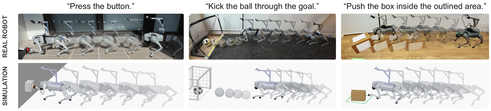
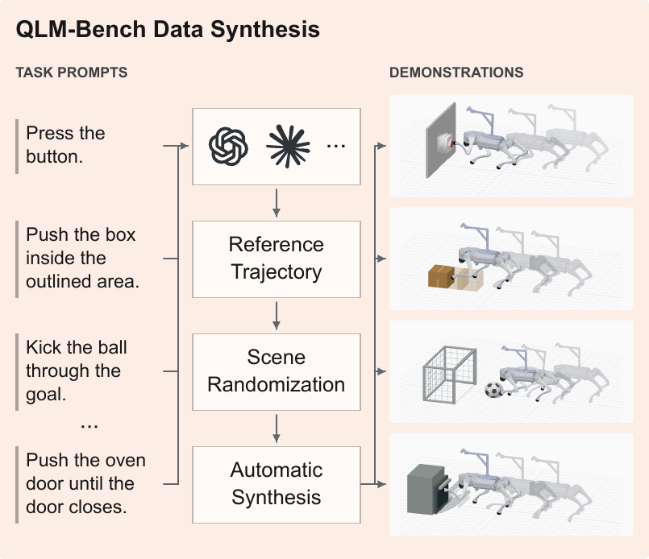

# QLM-Bench: Quadrupedal Loco-Manipulation Benchmark

Code repository for the QLM-Bench MuJoCo simulator and benchmark.

> **WAM-Policy: World Action Models with On-Policy Distillation for Quadrupedal Loco-Manipulation**
>
> [Junlin Long](https://github.com/JalenLoong)\*, [Xu Deng](https://github.com/Ethan-Xu-Deng)\*, [Yiran Wang](https://scholar.google.com/citations?user=eg_nBF0AAAAJ&hl=en), [Yue Yang](https://au.linkedin.com/in/yue-yang-982714286)†, [Yang Zhao](https://yangyangkiki.github.io/)†, and [Zeyu Zhang](https://steve-zeyu-zhang.github.io/)‡
>
> \*Equal contribution. †Corresponding authors. ‡Project lead.
>
> #### [Website](https://aigeeksgroup.github.io/WAM-Policy/) | [WAM-Policy code](https://github.com/AIGeeksGroup/WAM-Policy) | [WAM-Policy weights](https://huggingface.co/AIGeeksGroup/WAM-Policy) | [QLM-Bench code](https://github.com/AIGeeksGroup/QLM-Bench) | [QLM-Bench dataset](https://huggingface.co/datasets/AIGeeksGroup/QLM-Bench)

## ✏️ Citation

Citation will be added after publication.

---

## 🏃 Introduction

QLM-Bench (Quadrupedal Loco-Manipulation Benchmark) is a MuJoCo benchmark for language-conditioned loco-manipulation in which a Unitree Go2 manipulates with its front-left leg. A policy sees two RGB views and a language instruction and outputs 9-D commands for the RAMBO whole-body controller, which keeps the robot balanced and tracks the commanded base velocity and front-left foot target.



This repository provides the tasks, simulator, RAMBO controller port, Standard100 runner, training environments and demonstration-synthesis code. The companion Hugging Face dataset hosts the demonstrations, Standard100 suite, MuJoCo scene packs, RAMBO checkpoints and train800 reset pool. [QLM-Bench Dataset](https://huggingface.co/datasets/AIGeeksGroup/QLM-Bench)

### Tasks


| task | instruction | horizon |
|---|---|---|
| `push_box` | Push the box inside the outlined area. | 24 s |
| `press_button` | Press the button. | 24 s |
| `lift_basket` | Lift the basket by its handle. | 24 s |
| `kick_ball_to_goal` | Kick the ball through the goal. | 24 s |
| `sweep_block_to_zone` | Sweep the block into the outlined area. | 40 s |
| `close_fridge_door` | Push against the fridge door until the door closes. | 40 s |
| `close_oven_door` | Push the oven door until the door closes. | 60 s |
| `turn_valve` | Rotate the valve lever upward to the upright position. | 32 s |
| `pull_open_drawer` | Slide your foot into the drawer handle opening and pull the drawer outward. | 40 s |
| `open_room_door` | Press down the lever handle, then push the door open. | 60 s |

An episode succeeds when the task condition holds for three consecutive 50 Hz control ticks with the robot
not fallen; it fails on a fall and times out at the horizon.

### Observation and Action

- Observation: two 640×360 RGB views, `go2_ego` (head camera) and `d435i_rgb_task` (top-down camera),
  sampled every 80 ms, plus the instruction.
- Action: chunks of 16 commands at 50 Hz (0.32 s). A command is `rambo-native9-v2`:
  base `vx, vy, yaw_rate` and the absolute FL foot target `x, y, z` in the gravity-levelled base frame, plus a
  3-D foot force that is recorded but executed as zero.
- Simulation: native MuJoCo 3.8 on CPU (float64) at 500 Hz, RAMBO controller at 100 Hz on CPU, commands at 50 Hz.

## 📦 Data Preparation

### Demonstration Synthesis

For each task, a large multimodal model drafts a reference trajectory of commands from a short description of the task. After human review, the reference is retargeted to randomized scenes and executed by the whole-body controller, and the successful episodes are kept as demonstrations, with neither teleoperation nor hand-designed trajectories.



[Download the QLM-Bench Data Synthesis panel from Figure 2 (PDF)](./assets/qlm_bench_data_synthesis.pdf)

This gives 1,000 demonstrations, 100 per task, each recording the two camera streams, the executed commands, and a language instruction. The paper uses 800 training, 100 validation, and 100 test episodes. Each task contributes 20 Clean and 80 Randomized scenes. The canonical demonstrations are stored in LeRobot v2.1 under `canonical/lerobot_v2_1/mujoco-<task>-100-*`. See the dataset card for the file layout, formats, and supplementary releases. [QLM-Bench Dataset](https://huggingface.co/datasets/AIGeeksGroup/QLM-Bench)

The code includes the reviewed executors and recipes of the six articulated tasks, the reference traces
and template for push, press, lift and kick, and the executor libraries (`src/qlm_bench/synthesis/`).
`scripts/synthesis/example_one_demonstration.py` re-generates and checks one demonstration physics trace on a
Standard100 scene. The full 100-episode campaigns require the original scene-source assets and pilot records.
The Hugging Face dataset contains the resulting demonstrations. [Demonstration synthesis code and inputs](scripts/synthesis/README.md)

### Download Data

After [installation](#installation), download the Standard100 resources and demonstration releases from the [QLM-Bench dataset](https://huggingface.co/datasets/AIGeeksGroup/QLM-Bench) on `main`.

```bash
# Standard100 suite + 92 scene packs + RAMBO controller: ~19 GB on disk
# (many packs share meshes; ~1 GB of distinct content)
python -m qlm_bench.benchmark fetch --output data/standard100
# the 1,000 demonstrations (LeRobot v2.1); add --physical for the initial-state bundles
qlm data download --output data/qlm-bench
```

`fetch --case-id <id>` downloads only the scene packs of the given cases. The RAMBO controller checkpoint
(`assets/rambo-go2-controller/iteration-2000/runtime/model_2000.pt`, trained by the QLM-Bench authors with the RAMBO
code https://github.com/catachiii/rambo, commit 6f6c87c) comes with every Standard100 download.

### Training Reset Pool

The dataset publishes `reset_pools/train800-reset-pool.tar` for OPSD and M-OPD. It contains the 800 training initial states, their scene packs, and the RAMBO controller. Download it from the simulation environment and extract with GNU tar to preserve the hard links.

```bash
python - <<'PY'
from huggingface_hub import hf_hub_download
from qlm_bench.config import dataset_repo_id, dataset_revision

hf_hub_download(
    dataset_repo_id(),
    "reset_pools/train800-reset-pool.tar",
    repo_type="dataset",
    revision=dataset_revision(),
    local_dir="data/qlm-bench",
)
PY
tar -xf data/qlm-bench/reset_pools/train800-reset-pool.tar -C data/qlm-bench/reset_pools
```

Pass `data/qlm-bench/reset_pools/train800-reset-pool/manifest.json` to the streaming worker as `--pool`, or set `QLM_TRAIN_POOL` to the absolute manifest path in the WAM-Policy site configuration.

### Task RL Runtime Inputs

This code checkout includes the task inputs for `push_box` and `open_room_door`. In the WAM-Policy model environment, run the preparation command from the QLM-Bench checkout to unpack the case files and download the corresponding scene packs and controller. The example uses `push_box`. [Task RL inputs](inputs/task_rl)

```bash
python -m wam_policy.task_rl prepare --task push_box --inputs inputs/task_rl/push_box \
    --data-root data/task-rl --out data/task-rl/cases --download
```

## ⚙️ Environment Setup

### Installation

Clone this GitHub repository for the simulator, benchmark runner and training workers.

```bash
git clone https://github.com/AIGeeksGroup/QLM-Bench.git
cd QLM-Bench
```

Linux x86_64. Two environments are used:

- **Simulation environment** (Standard100, training environments, synthesis), Python ≥ 3.11 (the paper used 3.12):

  ```bash
  pip install -r requirements/mujoco-cpu.txt
  pip install -e . --no-deps
  ```

- **Policy environment** (only the `qlm-live-v1` protocol, e.g. the WAM-Policy model environment on Python 3.10):

  ```bash
  pip install -e "<QLM-Bench>[live]"
  ```

Rendering backends: Standard100 renders with **hardware EGL** (`MUJOCO_GL=egl`, NVIDIA driver); the training
workers render with **OSMesa / llvmpipe** on CPU (`libosmesa6`). `ffmpeg` is needed only to record videos.
`requirements/mujoco-cuda.constraints.txt` lists the optional MJWarp stack used for part of the demonstration
synthesis. See the [site configuration example](configs/site.example.env) for environment variables.

### Smoke Tests

One small run per main path (also a check of the local environment):

```bash
# Standard100: one episode against the dummy policy
python examples/dummy_policy_server.py --port 8765 &
python -m qlm_bench.benchmark run --resource-root data/standard100 --policy-port 8765 \
    --cases push100-20261014-091 --output /tmp/s100-smoke
# streaming training worker, both render modes, policy frames compared
python scripts/smoke/training_env_worker.py --pool <reset pool>/manifest.json --output /tmp/train-smoke --compare
# Task RL scene worker: one window, rollout-state capture and restore (OSMesa). Needs a data root with the scene
# packs and controller, prepared by WAM-Policy (unpacks inputs/task_rl and fetches the large files by sha256):
#   python -m wam_policy.task_rl prepare --task push_box --inputs inputs/task_rl/push_box --data-root <dir> --out <dir>/cases --download
# then take case/model from inputs/task_rl/push_box/scene-check-picks.json with @WORKSPACE@ = <dir>:
MUJOCO_GL=osmesa python scripts/smoke/task_rl_scene_worker.py \
    --case <dir>/task_rl/push_box/cases/push-approved-20261014-03.json \
    --model <dir>/task_rl/push_box/scenes/push-approved-20261014-03/scene.xml \
    --controller <dir>/assets/rambo-go2-controller/iteration-2000/runtime/model_2000.pt \
    --commands inputs/task_rl/push_box/commands/push-approved-20261014-03.npz --output /tmp/rl-smoke
# demonstration synthesis: one turn_valve trace with the approved executor
python scripts/synthesis/example_one_demonstration.py data/standard100 turn_valve-20261016-091 /tmp/valve-demo
```

## 🚀 Training

WAM-Policy provides the learner, model and training recipes. Clone it with `git clone https://github.com/AIGeeksGroup/WAM-Policy.git` to run those stages. [WAM-Policy Code](https://github.com/AIGeeksGroup/WAM-Policy)

### Training Environments (used by WAM-Policy)

| | entry point | paper stage |
|---|---|---|
| Streaming on-policy environment | `python -m qlm_bench.training_env worker ...` | 1.2 OPSD, 2.2 M-OPD |
| Task RL scene worker | `python -m qlm_bench.task_rl.scene_worker --controller ... --state-root ...` | 2.1 Task-Specific RL |

Both run native MuJoCo CPU physics with RAMBO on CPU. The streaming worker resets from the train-split reset
pool (80 train initial states per task, no held-out scene) and is scheduled across learner ranks by a shared
episode schedule. Use the [published reset pool](#training-reset-pool). The maintainer command `prepare-pool`
requires the original train-scene packs. The Task RL worker resets any train case, executes 16-command chunks,
and captures/restores full simulator snapshots at chunk boundaries. Its inputs are in `inputs/task_rl/`.

**Render-speed switch.** `--render-mode full|sampled` (or `QLM_RENDER_MODE`). `full` (default) renders the
policy views after every command plus the observer camera; `sampled` renders only at the 80 ms sample points
and skips the observer. The frames a policy receives are bit-identical; `sampled` is about 3–4× faster per
chunk. The paper used `full` for OPSD and `sampled` for M-OPD and Task RL. Standard100 always renders in full.

**Scene binding.** A scene pack's `resource-manifest.json` lists every file with its sha256; building a
runtime re-checks them and derives the scene's resource identity from them. Cases, reset pools and rollout
states name their scene by this identity, so a reset can never run on a different scene than recorded. The
identity is also the directory key of the scene packs on the dataset (`assets/<asset>/<identity>/`).

## 📊 Evaluation

### Run Standard100

Standard100 (`mujoco-standard-test100-v1`) contains ten held-out scene configurations (cases) per task, with a time limit of 24 to 60 s per task. Each task contributes two Clean and eight Randomized scenes reconstructed from their published initial states. The paper uses policy seeds 42, 43, and 44 on each case, for 300 episodes per policy. A policy seed only sets the initial noise of the policy, while the case fixes the scene, its reset, and the physics. Simulation waits for the policy at every chunk, so success rates do not depend on inference speed.

QLM-Bench is the client: start your policy server first, then run one process per policy seed.

```bash
python examples/dummy_policy_server.py --port 8765 &          # or your policy (see below)
python -m qlm_bench.benchmark run --resource-root data/standard100 --policy-port 8765 \
    --policy-seed 42 --output results/seed42                   # Standard100
scripts/benchmark/run_standard100.sh data/standard100 8765 results   # paper protocol: seeds 42, 43, 44
```

Each run writes `result.json` (per-task and overall success), `result/episodes.parquet`, a per-trial
`progress/` journal and `durable-outcomes/`. A run that ends with infrastructure errors is resumed with
`--previous-result <result.json>`: valid outcomes are kept and only the errored trials are retried
(`run_standard100.sh` does this automatically, up to `QLM_MAX_ATTEMPTS` attempts per seed). One policy server
can serve every seed, resumed run and parallel client: each attempt of each trial uses its own transport
session. `--cases a,b,...` restricts a run to some cases (useful to run several clients against one batched
policy server; not a Standard100 score). `--record-video` writes the policy views and the 720p observer camera.
`python -m qlm_bench.benchmark verify` reconstructs all 100 cases without a policy.

### Policy Interface

A policy is a localhost JSON-RPC server speaking `qlm-live-v1` (`qlm_bench.live`). It answers four calls:
`reset` (first observation of an episode), `predict` (return a 16-step native9 `ActionChunk` for the current
observation), `feedback` (the executed commands and the next observation) and `end` (payload `{reason}` at the end
of every episode; reply e.g. `{status: "ended"}`). `examples/dummy_policy_server.py`
is a complete minimal server; WAM-Policy's `wam_policy.inference.serve` is the server used in the paper.

### Reproducing the Paper

| Resource | Where to start |
|---|---|
| Standard100 tasks, metrics and protocol | [Runner and three-seed command](#run-standard100) |
| Demonstrations, held-out scenes and train800 | [QLM-Bench Dataset](https://huggingface.co/datasets/AIGeeksGroup/QLM-Bench) |
| WAM-Policy training and evaluation, including default and accelerated runners | [WAM-Policy Code](https://github.com/AIGeeksGroup/WAM-Policy) |
| Released teacher, students, specialists and ablation checkpoints | [WAM-Policy Models](https://huggingface.co/AIGeeksGroup/WAM-Policy) |

### Baselines

`baselines/leg_manip/` is a general re-implementation of the Leg-Manip baseline (controller + DP3 planner);
[Leg-Manip README](baselines/leg_manip/README.md)

## Interfaces for Policy and Training Code

**Standard100** (`python -m qlm_bench.benchmark`):

```
fetch   --output <resource_root> [--case-id ID ...] [--repo-id R] [--revision REV]
verify  --resource-root <resource_root> --output <report.json> [--case-id ID ...]
run     --resource-root <resource_root> --policy-port P --output <new dir> [--policy-seed {42,43,44}]
        [--cases id1,id2] [--policy-name NAME] [--record-video --ffmpeg F --ffprobe P]
        [--previous-result <result.json>] [--rpc-timeout-s 600] [--suite <dir>]
prepare --snapshot <dataset snapshot> --controller-root <dir> --output <dir> [--resource-map <json>]   # maintainers
```
Transport session of an episode: `evaluation-<task>/<case_id>/<trial_id>/attempt-NNN`. Exit code 0 iff every
expected trial has a task outcome (success / failure / timeout). Python: `qlm_bench.benchmark.run(resource_root,
output, *, policy_port, policy_seed=42, cases=None, ...)` (sets single-threaded torch and `MUJOCO_GL=egl` if
unset); `qlm_bench.benchmark.suite.{load_suite, reconstruct, runtime_for}` (`runtime_for` is Standard100-only and
requires hardware EGL; the Task RL scene worker uses only `reconstruct`).

**Streaming training environment** (`python -m qlm_bench.training_env <command>`):

```
worker --pool <manifest.json> --pool-sha256 <sha> --rank R --world-size W --port P --output <dir>
       --rpc-timeout-s T --wall-timeout-s T --segment S --training-profile <profile.json> --schedule-db <sqlite>
       [--max-episodes N] [--diagnostic] [--render-mode {full,sampled}]
make-profile --pool <manifest.json> --profile <out.json> [--tasks a,b] [--max-active-per-task N]
inspect-profile | schedule-init | schedule-snapshot | schedule-restore | schedule-stop | inspect-pool
prepare-pool --snapshot <dir> --output <dir> --controller-root <dir> [--resource-map <json>]   # maintainers
python -m qlm_bench.training_env.visualization --pool <manifest.json> --port P --output <dir>
```
The worker connects to the learner's `qlm-live-v1` server. Its `reset` request carries
`extensions['training'] = {train_pool_sha256, training_profile_sha256, train_episode_uid, segment,
schedule_ticket, render_mode, runtime: {physics, controller, rendering, rgb_profile}}` (`render_mode` and
`runtime.rendering` are informational). The learner stops the worker with `stop_after_feedback` in a feedback
response. Training profile (`qlm_bench.training_env.schedule.profile(pool_sha256, tasks=None,
max_active_per_task=2)`): `{schema: qlm-training-profile-v1, train_pool_sha256, training_horizons_s,
training_tasks, seed: 42, sampling, max_active_per_task, runtime}`; default = the nine training tasks
(all except `sweep_block_to_zone`) with two active episodes each. Python: `training_env.worker.select_cpu_environment`,
`training_env.schedule.EpisodeSchedule`.

**Task RL scene worker** (`python -m qlm_bench.task_rl.scene_worker --controller <model_2000.pt> --state-root <dir>
[--render-mode {full,sampled}]`, or in process `qlm_bench.task_rl.scene_worker.SceneWorker`): length-prefixed
JSON frames on stdin/stdout, envelope `{schema: qlm-task-rl-scene-ipc-v1, id, operation, session, payload}`.
Operations: `reset {case, model}`, `restore_state {case, model, path}`, `execute {chunk, commands (16×9), ring}`,
`capture_state {path}`, `persist_ring {chunk, path, origin}`, `inspect`. Execution results use schema
`qlm-task-rl-execution-v1` (RGB samples every 40 ticks, proprioception, privileged rows
`qlm-task-rl-privileged-v1`, terminal, progress); rollout states are `<name>.pt` + `<name>.json` +
`<name>.own.json` (`qlm-task-rl-rollout-state-v1`) under `--state-root`.

**Task RL inputs** (`inputs/task_rl/<task>/`): recorded absolute paths start with `@WORKSPACE@`, to be replaced by
the local data root; `scene-files.json` lists every scene file (and the controller under
`assets/rambo-go2-controller/iteration-2000/runtime/`) by sha256 so missing files can be fetched from the dataset.

## License

QLM-Bench is released under CC BY-NC 4.0 (see [LICENSE](LICENSE)). The RAMBO controller port is adapted from the
CC BY-NC 4.0 RAMBO code of Cheng et al. (RA-L 2025, https://github.com/catachiii/rambo); the controller
checkpoint distributed with the dataset was trained by the QLM-Bench authors with that code and is released under
CC BY-NC 4.0. The command/live interface files are shared with WAM-Policy, where they are provided under
Apache-2.0. Third-party components and assets, with their licenses, are listed in [THIRD_PARTY_NOTICES.md](THIRD_PARTY_NOTICES.md).
